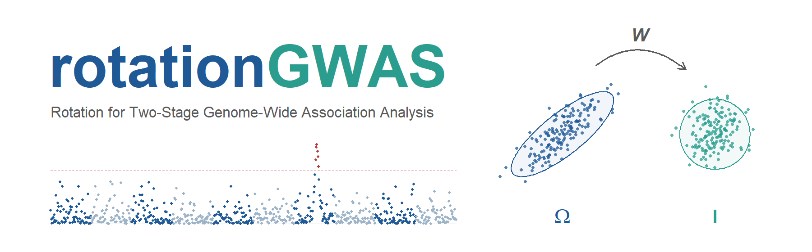

# rotationGWAS



Rotation for two-stage genome-wide association analysis of adjusted means from unbalanced field trials.

In a two-stage GWAS the adjusted means of the accessions from the first-stage analysis of the trial are the response of the second-stage marker model. In an unbalanced trial these means are estimated with unequal precision and are correlated, and most GWAS packages treat them as independent observations of equal precision. rotationGWAS carries the full first-stage variance-covariance matrix into the second stage by the rotation of Piepho et al. (2012): the adjusted means and every term of the second-stage model are pre-multiplied by the same matrix, after which the estimation errors are independent with unit variance and the second stage is an ordinary mixed-model GWAS. With known variance components the rotated two-stage analysis reproduces the single-stage analysis of the plot data.

The package starts after the first stage. It takes the adjusted means, their variance-covariance matrix, a relationship matrix, covariates and marker dosages as named R objects and matches them by accession name.

| Function | What it does |
|---|---|
| `rotation()` | checks and aligns the inputs, builds the rotation matrix, rotates the means, the intercept, the covariates and the relationship matrix, and fits the rotated model without a marker |
| `efficiency()`, `estimation_share()` | the loss of precision under inverse-variance weighting and under the unweighted analysis, for every marker, before any scan |
| `genome_scan()` | the P3D genome scan under the rotation, and under the two approximate schemes for comparison |
| `specification_test()` | tests the residual variance of the rotated model against its target value of one |
| `independent_effect()` | extends the model by an effect independent across accessions when the test finds the residual variance above one; the scan can then run under that model |
| `refit_markers()` | refits markers close to the threshold with the marker in the model and the residual variance fixed at one |
| `plot()` | the structure of the variance-covariance matrix, the efficiency along the genome, Manhattan and QQ plots of the scan, the profile of the residual variance test |

The vignette (`vignette("rotationGWAS")`) goes through these steps in the order of the paper's Conclusions on three synthetic rolling-panel trials shipped with the package, starting with the first stage in lme4 and emmeans.

## Installation

The package will be available from its GitHub repository and archived with a DOI on its release. Until then, install from the sources:

```r
# install.packages("remotes")
remotes::install_local("rotationGWAS", build_vignettes = TRUE)
```

The package imports only `stats`. The vignette's first stage uses lme4, emmeans and pbkrtest.

## Example

```r
library(rotationGWAS)
r <- rotation(panel_sparse$means, panel_sparse$Omega,
              panel_genotypes$relationship, panel_genotypes$covariates)
efficiency(r, panel_genotypes$markers)           # the loss of precision per marker, before the scan
s <- genome_scan(r, panel_genotypes$markers)     # the rotated scan
specification_test(r)                            # the residual variance against one
refit_markers(r, panel_genotypes$markers, scan = s, window = 1.5)
```

## Notes

The variance components are REML estimates from the package's own engine. They can differ from those of other software, for example rrBLUP's `mixed.solve`, in the fourth significant digit, which is the optimisers' tolerance, not a difference in the likelihood.

## Citation

Habib, Y., and H.-P. Piepho, 2026 Exact weighting in two-stage genome-wide association analysis: when does it matter? Manuscript.

Piepho, H.-P., J. Möhring, T. Schulz-Streeck and J. O. Ogutu, 2012 A stage-wise approach for the analysis of multi-environment trials. Biometrical Journal 54: 844-860.

See `citation("rotationGWAS")`.

## License

GPL (>= 3).
